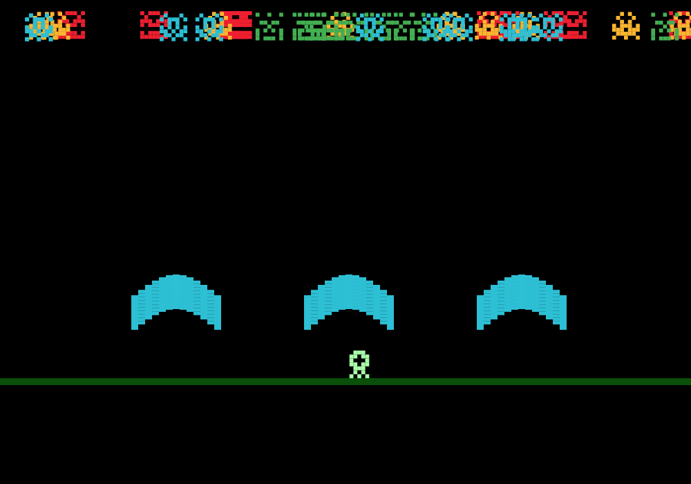

# space-invaders



**[Play it in the browser](https://theoestudio.github.io/space-invaders/)**

A small Space Invaders-style game I wrote in 2016 as the demo for **ion-cloud**, a JavaScript game library I was building at the time. Every invader is a random 7x7 sprite mirrored down the middle, so no two rounds look the same, and the sky cycles from dawn to midnight while you play.

Arrow keys move, space fires. On a phone, tap left or right of the ship to move and fire.

## Status

This project is finished and archived. ion-cloud was retired in 2026 and I don't do web development anymore, so the game stays pinned to the last ion-cloud release instead of being ported to another library. The live build above still works, and that's the version I'd point anyone to.

If you want to run it locally anyway:

```sh
npm ci
npm start
```
